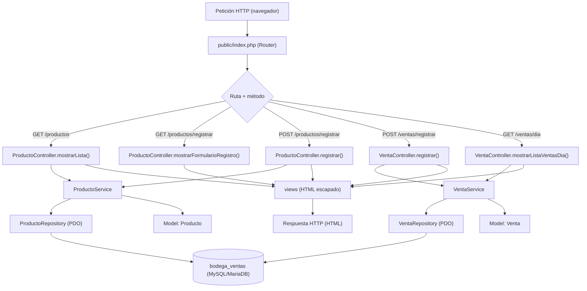
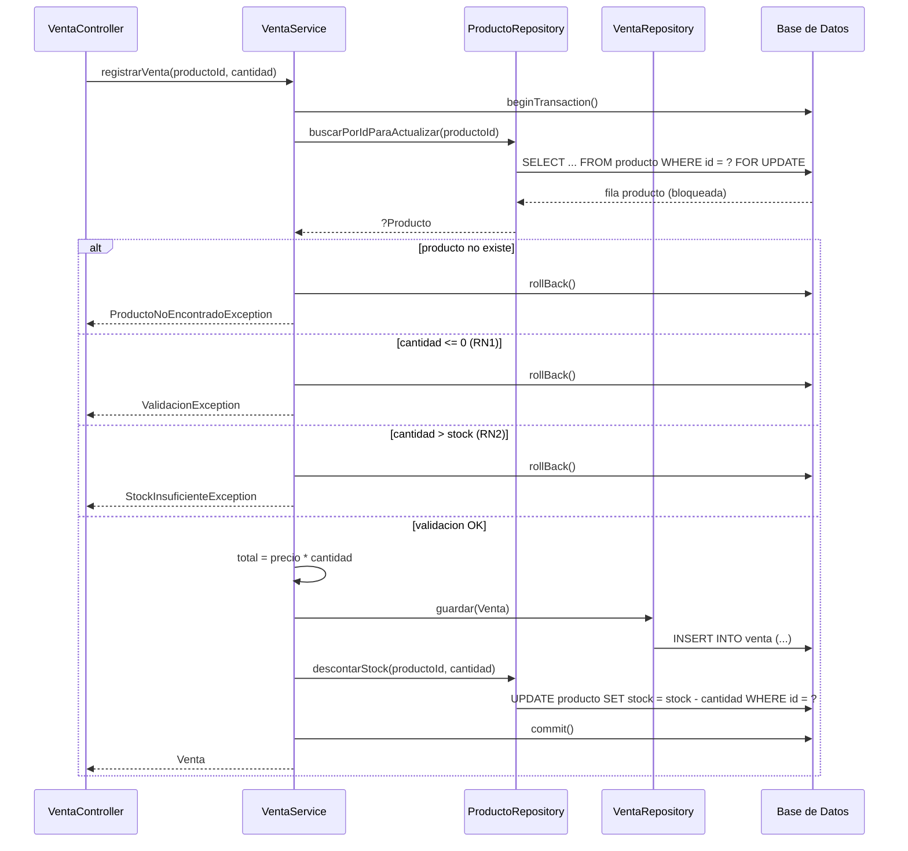

# Design Document

## Overview

Sistema de ventas y control de stock para el minimarket «La Esquina» (San Vicente de Cañete). Aplicación web interna ejecutada sobre el entorno local de XAMPP, con PHP 8 orientado a objetos (sin frameworks) y MySQL/MariaDB. Este documento deriva del análisis (`D0.md`) y de los requisitos aprobados en `requirements.md`.

Decisiones de diseño clave:
- **Arquitectura en capas estricta** (Model → Repository → Service → Controller → views) con `public/index.php` como punto de entrada, para mantener separadas la persistencia, las reglas de negocio y la presentación.
- **Interfaces de repositorio** para permitir repositorios falsos (doubles) en pruebas, de modo que la lógica de negocio se pruebe sin tocar la base de datos.
- **Transacción con bloqueo pesimista** (`SELECT ... FOR UPDATE`) en el registro de venta, para evitar condiciones de carrera cuando dos cajeros venden el mismo producto.
- **Validaciones duplicadas** en la capa Service como respaldo de las `CHECK` de la base de datos, porque no todas las versiones de MySQL/MariaDB de XAMPP las aplican.

---

## Architecture

La aplicación sigue una arquitectura en capas con dependencias unidireccionales: una capa superior puede depender de una inferior, pero nunca al revés. El flujo de una petición atraviesa las capas en orden y cada una tiene una única responsabilidad.

### Capa Model

**Qué hace:** Representa las entidades del dominio (`Producto`, `Venta`). Encapsula los datos de cada entidad y expone getters/setters tipados. Puede exponer consultas derivadas puras (p. ej. si el producto tiene stock bajo).

**Qué NO hace:** Ejecutar SQL, aplicar reglas de negocio, mostrar HTML, conocer la petición HTTP.

### Capa Repository

**Qué hace:** Persistir y consultar entidades ejecutando SQL con PDO y sentencias preparadas. Realiza el mapeo entre filas de la base de datos y objetos Model. Implementa interfaces (`ProductoRepositoryInterface`, `VentaRepositoryInterface`) para permitir repositorios falsos en pruebas.

**Qué NO hace:** Validar reglas de negocio, mostrar HTML, leer la petición HTTP, decidir cuándo iniciar o confirmar una transacción (eso lo hace el Service).

### Capa Service

**Qué hace:** Contiene las reglas de negocio (RN1 a RN5). Valida datos, calcula totales y orquesta transacciones de base de datos (`beginTransaction` / `commit` / `rollBack`).

**Qué NO hace:** Ejecutar SQL directamente (lo hace a través de los Repository), mostrar HTML, leer la petición HTTP.

### Capa Controller

**Qué hace:** Recibe la petición HTTP, extrae los datos, valida el token CSRF, delega la operación al Service correspondiente y prepara los datos (Model o arrays) para la vista.

**Qué NO hace:** Ejecutar SQL, aplicar reglas de negocio, generar HTML.

### Capa views

**Qué hace:** Renderiza HTML usando exclusivamente datos ya escapados que recibe del Controller.

**Qué NO hace:** Ejecutar SQL, aplicar reglas de negocio, acceder directamente a la petición HTTP, ejecutar lógica de negocio.

### public/index.php

**Qué hace:** Punto de entrada único. Lee la ruta y el método HTTP y enruta la petición al Controller correspondiente. Carga las dependencias (conexión PDO, lectura de `.env`, repositorios, services, controllers).

**Qué NO hace:** Contener lógica de negocio, ejecutar SQL directamente, generar HTML.

### Diagrama de flujo de una petición



**Dirección de dependencias:** `views ← Controller ← Service ← Repository ← Model`. La base de datos solo es accedida por los Repository mediante PDO. Los Service no conocen PDO directamente; orquestan la transacción pero delegan el SQL a los Repository.

---

## Data Models

Base de datos: `bodega_ventas`, charset `utf8mb4`, motor `InnoDB` (necesario para soportar transacciones, claves foráneas y bloqueos pesimistas `FOR UPDATE`).

### SQL de creación

```sql
CREATE DATABASE IF NOT EXISTS bodega_ventas
    CHARACTER SET utf8mb4
    COLLATE utf8mb4_unicode_ci;

USE bodega_ventas;

CREATE TABLE producto (
    id           INT           NOT NULL AUTO_INCREMENT,
    codigo       VARCHAR(10)   NOT NULL,
    nombre       VARCHAR(100)  NOT NULL,
    categoria    VARCHAR(50)   NOT NULL,
    precio       DECIMAL(10,2) NOT NULL,
    stock        INT           NOT NULL,
    stock_minimo INT           NOT NULL,
    PRIMARY KEY (id),
    UNIQUE KEY uk_producto_codigo (codigo),
    CHECK (precio >= 0),
    CHECK (stock >= 0),
    CHECK (stock_minimo >= 0)
) ENGINE=InnoDB
  DEFAULT CHARSET=utf8mb4
  COLLATE=utf8mb4_unicode_ci;

CREATE TABLE venta (
    id              INT           NOT NULL AUTO_INCREMENT,
    producto_id     INT           NOT NULL,
    cantidad        INT           NOT NULL,
    precio_unitario DECIMAL(10,2) NOT NULL,
    total           DECIMAL(10,2) NOT NULL,
    fecha_hora      DATETIME      NOT NULL,
    PRIMARY KEY (id),
    CONSTRAINT fk_venta_producto
        FOREIGN KEY (producto_id) REFERENCES producto(id),
    CHECK (cantidad > 0)
) ENGINE=InnoDB
  DEFAULT CHARSET=utf8mb4
  COLLATE=utf8mb4_unicode_ci;
```

### Nota sobre las restricciones `CHECK`

La sintaxis `CHECK` está incluida para documentar las restricciones de rango (RN1, RN3 y la no negatividad del stock). Sin embargo, **MySQL/MariaDB de XAMPP puede no soportar ni aplicar `CHECK` en todas sus versiones** (versiones antiguas de MySQL ignoran las `CHECK`; MariaDB sí las aplica desde 10.2.1). Por ello, **las validaciones de rango también se aplican en la capa Service como respaldo**, de modo que la integridad de los datos no dependa exclusivamente del motor de base de datos.

### Mapeo entre base de datos y Model

| Tabla (snake_case) | Model (camelCase) |
|---|---|
| `producto.stock_minimo` | `Producto.stockMinimo` |
| `venta.producto_id` | `Venta.productoId` |
| `venta.precio_unitario` | `Venta.precioUnitario` |
| `venta.fecha_hora` | `Venta.fechaHora` |

El Repository es responsable de traducir entre las columnas de la base de datos y los atributos del Model.

---

## Components and Interfaces

Todas las clases declaran `declare(strict_types=1)`. A continuación se muestran **solo firmas (contratos), no implementación**.

### Models

```php
<?php
declare(strict_types=1);

class Producto
{
    private ?int $id = null;
    private string $codigo;
    private string $nombre;
    private string $categoria;
    private float $precio;
    private int $stock;
    private int $stockMinimo;

    public function __construct(
        string $codigo,
        string $nombre,
        string $categoria,
        float $precio,
        int $stock,
        int $stockMinimo
    ) {}

    public function getId(): ?int {}
    public function getCodigo(): string {}
    public function getNombre(): string {}
    public function getCategoria(): string {}
    public function getPrecio(): float {}
    public function getStock(): int {}
    public function getStockMinimo(): int {}

    public function setId(int $id): void {}
    public function setCodigo(string $codigo): void {}
    public function setNombre(string $nombre): void {}
    public function setCategoria(string $categoria): void {}
    public function setPrecio(float $precio): void {}
    public function setStock(int $stock): void {}
    public function setStockMinimo(int $stockMinimo): void {}

    /** True cuando Stock_Actual <= Stock_Minimo (criterio de alerta, RF2-AC2). */
    public function tieneStockBajo(): bool {}
}
```

```php
<?php
declare(strict_types=1);

class Venta
{
    private ?int $id = null;
    private int $productoId;
    private int $cantidad;
    private float $precioUnitario;
    private float $total;
    private \DateTimeInterface $fechaHora;

    public function __construct(
        int $productoId,
        int $cantidad,
        float $precioUnitario,
        float $total,
        \DateTimeInterface $fechaHora
    ) {}

    public function getId(): ?int {}
    public function getProductoId(): int {}
    public function getCantidad(): int {}
    public function getPrecioUnitario(): float {}
    public function getTotal(): float {}
    public function getFechaHora(): \DateTimeInterface {}

    public function setId(int $id): void {}
    public function setProductoId(int $productoId): void {}
    public function setCantidad(int $cantidad): void {}
    public function setPrecioUnitario(float $precioUnitario): void {}
    public function setTotal(float $total): void {}
    public function setFechaHora(\DateTimeInterface $fechaHora): void {}
}
```

### Interfaces de repositorios (para usar repositorios falsos en pruebas)

```php
<?php
declare(strict_types=1);

interface ProductoRepositoryInterface
{
    /** @return Producto[] */
    public function buscarTodos(): array;

    public function buscarPorId(int $id): ?Producto;

    public function buscarPorCodigo(string $codigo): ?Producto;

    /** @return int ID generado */
    public function guardar(Producto $producto): int;

    public function existeCodigo(string $codigo): bool;

    /** SELECT ... FOR UPDATE — lectura con bloqueo pesimista (para la transacción de venta). */
    public function buscarPorIdParaActualizar(int $id): ?Producto;

    /** UPDATE producto SET stock = stock - cantidad WHERE id = ? — descuento de stock dentro de la transacción. */
    public function descontarStock(int $id, int $cantidad): void;
}
```

```php
<?php
declare(strict_types=1);

interface VentaRepositoryInterface
{
    /** @return int ID generado */
    public function guardar(Venta $venta): int;

    /** @return Venta[] ventas de la fecha indicada (00:00 a 23:59) */
    public function buscarVentasDelDia(\DateTimeInterface $fecha): array;

    /** @return Venta[] */
    public function buscarTodos(): array;
}
```

### Implementaciones PDO

```php
<?php
declare(strict_types=1);

class ProductoRepository implements ProductoRepositoryInterface
{
    public function __construct(private \PDO $pdo) {}
    // Todos los métodos usan PDO con sentencias preparadas y parámetros vinculados.
    // Sin implementación aquí: solo el contrato de la clase.
}
```

```php
<?php
declare(strict_types=1);

class VentaRepository implements VentaRepositoryInterface
{
    public function __construct(private \PDO $pdo) {}
    // Todos los métodos usan PDO con sentencias preparadas y parámetros vinculados.
    // Sin implementación aquí: solo el contrato de la clase.
}
```

### Services

```php
<?php
declare(strict_types=1);

class ProductoService
{
    public function __construct(
        private ProductoRepositoryInterface $productoRepository
    ) {}

    /**
     * Registra un producto nuevo.
     * Valida RN3 (precio >= 0), RN4 (codigo unico) y la no negatividad del stock.
     * Lanza ValidacionException si alguna validacion falla.
     */
    public function registrarProducto(
        string $codigo,
        string $nombre,
        string $categoria,
        float $precio,
        int $stock,
        int $stockMinimo
    ): Producto {}

    /** @return Producto[] */
    public function listarProductos(): array {}

    /**
     * @return Producto[] productos marcados cuando Stock_Actual <= Stock_Minimo
     * (criterio de alerta RF2-AC2).
     */
    public function listarProductosConAlertaStock(): array {}
}
```

```php
<?php
declare(strict_types=1);

class VentaService
{
        public function __construct(
        private \PDO $pdo,
        private ProductoRepositoryInterface $productoRepository,
        private VentaRepositoryInterface $ventaRepository
    ) {}

    /**
     * Registra una venta dentro de una transaccion:
     * beginTransaction -> buscarPorIdParaActualizar (FOR UPDATE) -> validar RN1 y RN2
     * -> guardar venta -> descontar stock -> commit; rollBack en catch.
     * Lanza ValidacionException (RN1), StockInsuficienteException (RN2)
     * o ProductoNoEncontradoException.
     */
    public function registrarVenta(int $productoId, int $cantidad): Venta {}

    /** @return Venta[] ventas del dia calendario actual (00:00 a 23:59) */
    public function listarVentasDelDia(): array {}

    /** Suma de los totales de todas las ventas del dia, en soles (S/) */
    public function calcularTotalDelDia(): float {}
}
```

### Controllers

```php
<?php
declare(strict_types=1);

class ProductoController
{
    public function __construct(
        private ProductoService $productoService,
        private CsrfGuard $csrf
    ) {}

    public function mostrarLista(): void {}

    public function mostrarFormularioRegistro(): void {}

    /** Valida CSRF y delega a ProductoService. */
    public function registrar(Request $request): void {}
}
```

```php
<?php
declare(strict_types=1);

class VentaController
{
    public function __construct(
        private VentaService $ventaService,
        private CsrfGuard $csrf
    ) {}

    public function mostrarFormularioRegistro(): void {}

    /** Valida CSRF y delega a VentaService. */
    public function registrar(Request $request): void {}

    public function mostrarListaVentasDia(): void {}
}
```

### Excepciones propias

```php
<?php
declare(strict_types=1);

class ValidacionException extends \InvalidArgumentException {}
class StockInsuficienteException extends \RuntimeException {}
class ProductoNoEncontradoException extends \RuntimeException {}
```

### Componentes de soporte

```php
<?php
declare(strict_types=1);

/** Abstraccion ligera de la peticion HTTP para que los Controllers no lean $_GET/$_POST directamente. */
class Request
{
    public function getMethod(): string {}
    public function getInput(string $key, mixed $default = null): mixed {}
    public function all(): array {}
    public function getCsrfToken(): ?string {}
}

/** Genera y valida el token CSRF (almacenado en sesion). */
class CsrfGuard
{
    public function generarToken(): string {}
    public function validarToken(?string $token): bool {}
}

/** Lee las credenciales desde el archivo .env (fuera del control de versiones). */
class EnvLoader
{
    /** @return array{host:string,db:string,user:string,password:string} */
    public static function cargar(string $rutaEnv): array {}
}
```

---

## Transaction Flow

El registro de una venta (RF3, RNF5, RN5) es la operación más delicada del sistema: debe registrar la venta **y** descontar el stock de forma atómica. Por eso se ejecuta dentro de una transacción con bloqueo pesimista.

### Flujo paso a paso

1. **`beginTransaction()`** — inicia la transacción.
2. **Leer el producto con `SELECT ... FOR UPDATE`** (`ProductoRepository::buscarPorIdParaActualizar`) — bloquea la fila del producto hasta el `commit` para que ningún otro proceso pueda modificarla mientras dura la transacción.
3. **Validar las reglas de negocio** (en `VentaService`):
   - Si el producto no existe → lanzar `ProductoNoEncontradoException`.
   - RN1: si `cantidad <= 0` → lanzar `ValidacionException`.
   - RN2: si `cantidad > stock` → lanzar `StockInsuficienteException`.
4. **Calcular el total** de la venta como `Precio_Venta * cantidad` y construir el objeto `Venta` con la fecha y hora actuales.
5. **Insertar la venta** (`VentaRepository::guardar`).
6. **Descontar el stock** (`ProductoRepository::descontarStock`: `UPDATE producto SET stock = stock - cantidad WHERE id = ?`).
7. **`commit()`** — confirma ambas operaciones de forma atómica.
8. En el `catch`: **`rollBack()`** y **relanzar la excepción** correspondiente, de modo que ni la venta quede registrada ni el stock quede modificado.

### Diagrama de secuencia



### ¿Por qué `SELECT ... FOR UPDATE`?

El bloqueo pesimista evita una condición de carrera: supongamos que el producto tiene 5 unidades en stock y dos cajeros registran, casi al mismo tiempo, una venta de 3 unidades cada uno.

- **Sin `FOR UPDATE`:** ambas lecturas ven `stock = 5`; ambas validan `3 <= 5` (correcto); ambas descontarían y el stock quedaría en `-1`. Se vendió más de lo que había, vulnerando RN2.
- **Con `FOR UPDATE`:** la primera transacción bloquea la fila del producto; la segunda lectura `FOR UPDATE` queda en espera hasta que la primera hace `commit` o `rollBack`. La segunda transacción entonces ve el stock ya descontado (2) y rechaza la venta de 3 unidades porque `3 > 2`.

Aunque el sistema se usa normalmente por un solo cajero a la vez (supuesto de `D0.md`), el bloqueo protege la integridad si dos peticiones concurrentes llegan a ocurrir.

---

## Error Handling

### Excepciones propias y su uso

| Excepción | Hereda de | Se lanza cuando | Criterio / regla |
|---|---|---|---|
| `ValidacionException` | `\InvalidArgumentException` | El precio es negativo, el código ya existe, falta un dato obligatorio, o la cantidad vendida es `<= 0` | RN1, RN3, RF1-AC2, RF1-AC3, RF1-AC4, RF3-AC2 |
| `StockInsuficienteException` | `\RuntimeException` | La cantidad vendida supera el `Stock_Actual` del producto | RN2, RF3-AC3 |
| `ProductoNoEncontradoException` | `\RuntimeException` | El producto elegido para la venta no existe en la base de datos | RF3-AC4 |

### Reglas de manejo

- **Registro inexistente:** cuando `buscarPorId` (o `buscarPorCodigo`) no encuentra una fila, **devuelve `null`**, no lanza una excepción. Es el Service quien decide, según el contexto, si `null` es un error (venta de un producto inexistente → `ProductoNoEncontradoException`) o un resultado válido (buscar un código para comprobar unicidad).
- **Error de base de datos:** una conexión fallida o un error de consulta lanza una excepción (la `PDOException` original o una excepción propia que la envuelva). Estas son errores técnicos, no se muestran al usuario.
- **Mensajes al usuario:** al usuario solo se le muestran **mensajes claros y comprensibles** en lenguaje natural (p. ej. "La cantidad debe ser mayor que cero", "No hay stock suficiente. Stock disponible: N"). **Nunca** se muestran trazas de pila ni detalles técnicos.
- **Captura en el Controller:** los Controllers capturan las excepciones lanzadas por los Services (`ValidacionException`, `StockInsuficienteException`, `ProductoNoEncontradoException`) y preparan un mensaje de error para mostrarlo en la vista, manteniendo el estado actual (p. ej. no se modifica el stock). Las excepciones de base de datos se capturan en un nivel superior y muestran un mensaje genérico de error del sistema.

---

## Security

### PDO y sentencias preparadas (RNF1)

Todas las consultas a la base de datos se ejecutan con **PDO y sentencias preparadas**, vinculando cada valor proporcionado por el usuario como un parámetro (`bind`) en lugar de concatenarlo en la cadena SQL. Nunca se construye SQL por concatenación de texto. Esto previene la inyección SQL en toda lectura y escritura.

### Token CSRF (RNF2)

- Los formularios que modifican datos (registro de producto y registro de venta) incluyen un **campo oculto** con un token CSRF generado por `CsrfGuard::generarToken()` (almacenado en la sesión).
- Al enviarse el formulario, el Controller llama a `CsrfGuard::validarToken()` y **compara el token recibido con el esperado antes de procesar la solicitud**.
- Si el token está ausente o no coincide, el Controller **rechaza la solicitud sin procesarla** y muestra un mensaje de error.

### Salida escapada / XSS (RNF3)

Toda información mostrada en la interfaz (proveniente de la base de datos o ingresada por el usuario) se pasa por **`htmlspecialchars()` con `ENT_QUOTES` y codificación `UTF-8`** en las vistas, de modo que el contenido se muestre como texto literal y no se interprete como HTML o JavaScript. Si el contenido contiene etiquetas HTML o scripts, se muestran como texto en lugar de ejecutarse.

### Credenciales en archivo `.env` (RNF4)

- Las credenciales de la base de datos (host, nombre de la base de datos, usuario y contraseña) se leen desde un archivo **`.env`** mediante `EnvLoader`, y ese archivo está **excluido del control de versiones** (listado en `.gitignore`).
- Si el archivo `.env` no existe o no contiene todas las credenciales necesarias, el Sistema muestra un mensaje de error indicando que no se pudieron cargar las credenciales y **no inicia la conexión** a la base de datos.
- Las credenciales **nunca van hardcodeadas** en el código fuente: se mantienen exclusivamente en el archivo `.env`.


---

## Correctness Properties

Las propiedades de corrección del sistema se validan a través de los criterios de aceptación definidos en `requirements.md`. Se evaluó la aplicabilidad de las pruebas basadas en propiedades (PBT), pero se determinó que **no son aplicables al alcance de esta funcionalidad**: las reglas de negocio (RN1 a RN5) consisten en validaciones de rango simples (p. ej. `precio >= 0`, `cantidad > 0`, `cantidad <= stock`) y operaciones CRUD sobre la base de datos, sin funciones puras con un espacio de entrada amplio que justifiquen PBT.

Por ello, en lugar de PBT se utilizan **pruebas unitarias con repositorios falsos** (para la lógica de negocio pura) y **pruebas de integración** (para la transacción de venta con `SELECT ... FOR UPDATE` y el descuento de stock). Véase la sección *Testing Strategy* para el detalle.

---

## Testing Strategy

La estrategia de pruebas combina dos enfoques complementarios:

- **Pruebas unitarias:** los Services (`ProductoService`, `VentaService`) se prueban con **repositorios falsos** (doubles que implementan `ProductoRepositoryInterface` y `VentaRepositoryInterface`), de modo que la lógica de negocio (RN1 a RN5) se valida **sin tocar la base de datos**. Cada caso de validación de rango, unicidad de código y stock insuficiente se cubre con ejemplos concretos y casos límite (p. ej. `cantidad = 0`, `cantidad = stock`, `cantidad = stock + 1`, `precio = 0`).
- **Ejecución:** todas las pruebas están en `tests/run.php`, se ejecutan con `php tests/run.php`, sin PHPUnit ni Composer y sin conexión a la base de datos. La transacción real se verifica manualmente en el navegador (por ejemplo, intentar vender 5 unidades de P008 con stock 2 y comprobar que el stock no cambia).
